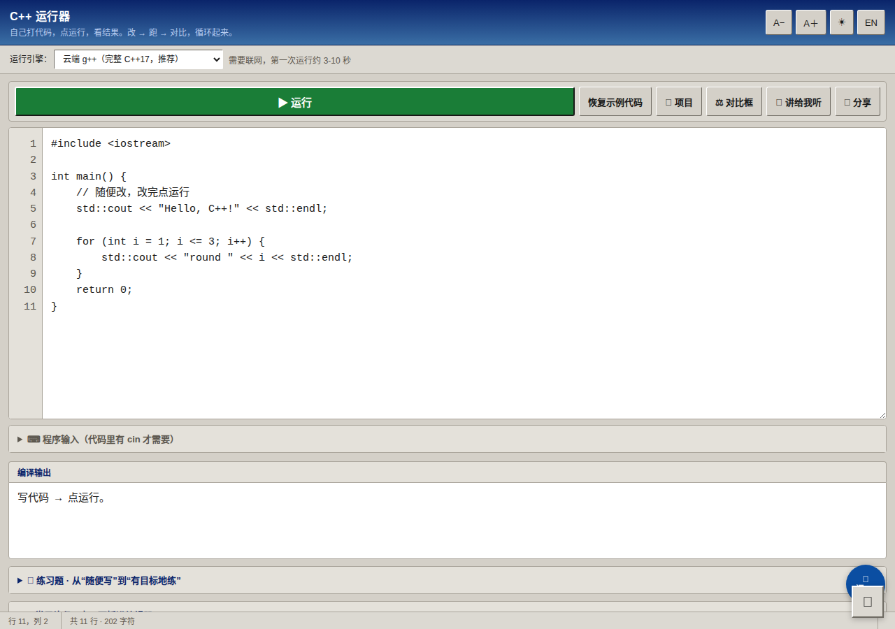
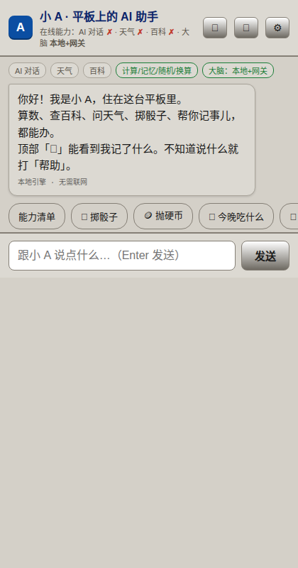

# C++ 运行器 · C++ Runner

> 打开网页就能写 C++、跑 C++——不用装环境，手机、平板、电脑通吃。

🔗 **在线体验：<https://andy-hub-byte.github.io/C-plus-plus/>**


---

## 为什么做这个

学 C++ 第一道门槛不是语法，是环境：VS 装一下午、MinGW 配半天 path、机房电脑还没权限。这个项目把编译器和运行界面搬进一个网页——点开链接就能写 `hello world`，30 秒看到运行结果。

## ✨ 特性

| 特性 | 说明 |
|------|------|
| ☁️ **云端真编译** | 对接 Godbolt（Compiler Explorer）公共 API，真实 g++ 编译运行，带退出码和耗时，不是假装能跑的模拟器 |
| 🈯 **中英双语** | 全站 448 处界面文案一键切换（`i18n` 引擎，1141 条词典），选择记在 localStorage，刷新不丢 |
| 📱 **移动端适配** | 420px 平板视口实测无横向溢出，触屏快捷指令可用 |
| 🎮 **内置游戏** | 2048、跳跃小鸟、3D 赛车——课间放松用，全是纯前端实现 |
| 🤖 **小 A 助手** | 见 [`agent/`](agent/)：本地 backbone + 魔搭大模型 + 工具调用，三级降级保底 |
| 💾 **项目保存** | 代码存 localStorage，刷新/误关网页都不丢 |

## 📸 截图

| 中文界面 | 平板上的小 A 助手 |
|:---:|:---:|
|  |  |

## 🚀 快速开始

**方式一（推荐）**：直接打开 <https://andy-hub-byte.github.io/C-plus-plus/>

**方式二**：下载本仓库，双击 `index.html`——纯静态、零依赖、零构建。

**方式三**：GitHub Pages 自己部署一份——Fork 后 Settings → Pages → 选 main 分支，一分钟上线。

## 📁 目录结构

```
├── index.html          # 主应用：编辑器 + 云端编译 + 游戏 + i18n，单文件
├── agent/
│   └── index.html      # 小 A：AI 助手（魔接 ModelScope + function calling）
├── docs/               # README 截图
└── social-preview.png  # 仓库社交预览图
```

## 🛠 技术亮点

- **i18n 引擎**：自研词典替换（TreeWalker 遍历文本节点 + 属性键双空间映射），448 处文案包裹，注入后静态校验 429 个键全覆盖
- **E2E 测试**：Playwright 36 项全绿——双语切换、持久化、云端实跑（g++ 5.3s）、420px 移动端、console 零错误
- **小 A 的三级降级**：魔搭大模型（有 Key）→ 公共 AI 网关 → 本地大脑（算数/记忆/掷骰子/换算），任何一层挂了对用户无感
- **function calling 两轮循环**：大模型自己决定调 `get_weather` / `wiki_lookup` / `remember_fact`，工具结果回灌后生成总结，回复里标注调了哪些工具

## 🤖 小 A 助手

[`agent/index.html`](agent/index.html) 是一个住在网页里的中文 AI 助手：

- **没配 Key 也能用**：算数、单位换算、掷骰子、抽签、报时、记事——本地 backbone 全免费
- **配了魔搭 Key 就是真 agent**：接 [ModelScope](https://modelscope.cn)（OpenAI 兼容 + function calling），大模型自己决定什么时候查天气、查百科、记备忘
- **怎么配**：打开 agent 页面 → ⚙️ 设置 → 粘贴魔搭访问令牌 → 保存。免费额度日常够用。

## ⚠️ 已知限制

- 云端编译走 Godbolt（Compiler Explorer）公共实例，偶发限流；编译内核与标准库版本以对方实例为准
- 维基百科接口在国内网络环境下可能超时，失败时小 A 会自动降级应答，不会卡死
- 小 A 的魔搭 Key 只存在你自己浏览器的 localStorage，不经过任何第三方服务器

## 📄 License

MIT

---

如果这个项目对你有用，点个 ⭐ Star 就是最好的反馈。
